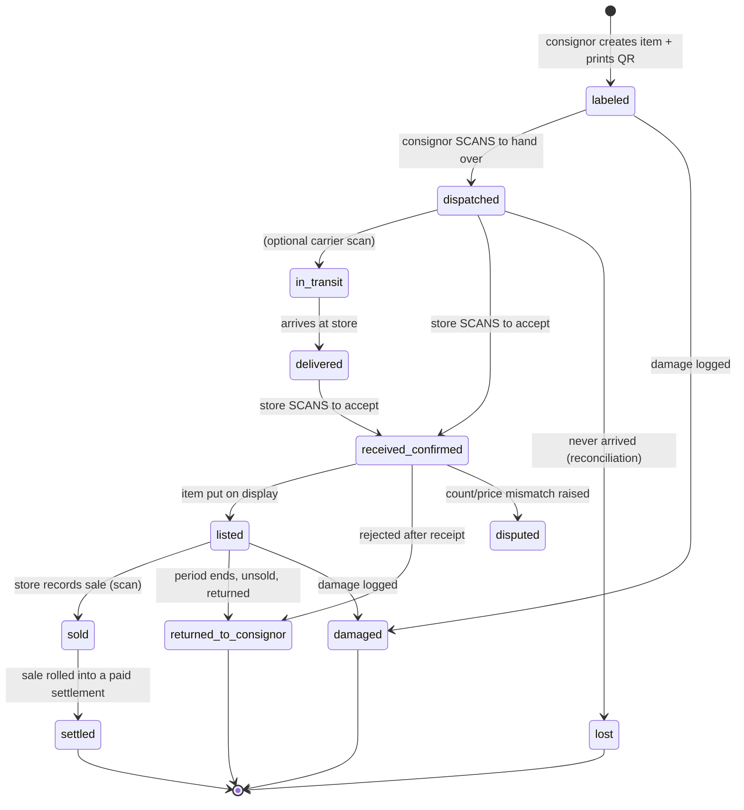
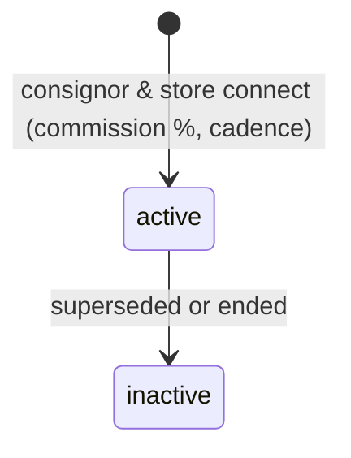

# ConsignTrack — Consignment State Machine & Data Architecture

> Product-architecture reference. Every state below maps to a real column in
> `supabase/migrations/`. Legend: **[built]** exists today · **[partial]** exists
> but incomplete · **[gap]** not yet built.

---

## 0. The two ambiguous fields, resolved

The whiteboard draft put "time period" and "amount" on the **product**. Both are wrong there.

| Draft field | Belongs on | Why |
|---|---|---|
| `price` | **Product** (`products.unit_price`) | The catalogue asking price. The *only* money fact that is intrinsic to the product. |
| `amount` (qty × value) | **Delivery Line Item** / **Sale Item** (`qty × unit_price`) | "Amount" is always a *line* computation, never a stored product attribute. Storing it invites drift. It is derived, never written. |
| `quantity` | **Delivery Line Item**, not Product | A product has no quantity; a *shipment of* a product does. Stock on hand lives in `stock_levels`. |
| "time period" (consignment window) | **Agreement** (default) → **Item** (concrete dates) | The *policy* ("goods may sit 60 days") is a commercial term → Agreement. The *actual* window for a specific item (received 3 Nov → expires 2 Jan) is computed and pinned on the Item at receipt. |
| "time period" (settlement rhythm) | **Agreement** (`settlement_cadence`) | Weekly / monthly / quarterly payout is a per-partner term. **[built]** |

**Rule:** the Product record is a thin catalogue entry — `name`, `sku`, `unit_price`, owner. Everything quantitative or time-bound is a property of a *relationship* (Agreement) or an *event* (Delivery, Sale), never the product.

---

## 1. State machine

The unit that moves through states is the **serialized Item** (`items` table), not the
batch. Each item carries its own `status` + `current_holder` and is reconciled individually —
that is what makes the chain of custody auditable. The batch (`deliveries`) has a coarser
status that is *derived* from its items.

### 1a. Item lifecycle — the spine **[built]**

`items.status` enum (migration `0009`):



| From → To | Trigger (action) | Role that performs it | Record it creates |
|---|---|---|---|
| ∅ → `labeled` | Create item, auto-SKU, mint signed QR | **Consignor** | `items` row + `scan_events`(create) + auto-`products` row (`0011`) |
| `labeled` → `dispatched` | **Scan QR** to hand over | **Consignor** | `scan_events`(dispatch); sets delivery → `sent` (`0013`) |
| `dispatched` → `received_confirmed` | **Scan same QR** to accept | **Store staff** | `scan_events`(receive) + `stock_movements`(+1) + `stock_levels` ↑ (`0011`) |
| `received_confirmed` → `listed` | Put on display | Store staff | `items.status` update (+ display-expiry pin — **[gap]**) |
| `listed` → `sold` | Record sale (scan) | Store staff | `sales` + `sale_items` + `stock_movements`(−1) (`0011`) |
| `sold` → `settled` | Close settlement period | Store manager / admin | `settlements` + `settlement_lines` + `payments` |
| `listed` → `returned_to_consignor` | Period end, return scan | Store staff → Consignor | `returns` + `stock_movements`(−1) |
| any → `lost`/`damaged` | Exception logged | Either side | `exceptions` row (`0009`) |
| `received_confirmed` → `disputed` | Mismatch raised | Either side | `disputes` row (`0009`) |

**Why dual-scan is the keystone:** an item can *only* leave the consignor by a consignor-signed
scan, and can *only* become sellable store stock by a store-signed scan of the **same** HMAC QR
token (`extensions.hmac`, migration `0009`). Neither side can unilaterally assert a handoff —
that is the structural accountability the whiteboard asked for.

### 1b. Batch / delivery status — derived **[built]**

`deliveries.status`: `draft → sent → confirmed`. Driven by item scans, not set by hand
(`0013`): first dispatch scan flips `draft→sent`; when every item in the batch is
`received_confirmed`, the delivery flips `→confirmed`.

### 1c. Agreement precedes everything **[built]**



`agreements` enforces **at most one active agreement per (consignor, store)** via a partial
unique index. **No delivery can be drafted without an active agreement** — this is the
"agreement step before deliveries" gap from the draft, already closed (`0012` `connect_agreement`).

---

## 2. Core entities

| Entity | Table **[status]** | Key fields | Relationships |
|---|---|---|---|
| Consignor | `consignors` **[built]** | name, contact, type | 1—N products, agreements, items |
| Store | `stores` **[built]** | name, location, manager | 1—N agreements, sales, stock |
| User/role | `app_users` **[built]** | role (`consignor`/`store_manager`/`store_staff`/`admin`), scope FK | maps auth → scope |
| **Agreement** | `agreements` **[built]** | commission_pct, settlement_cadence, is_active | (consignor, store) unique active |
| Product | `products` **[built]** | name, sku (auto), unit_price | N—1 consignor |
| Delivery (batch) | `deliveries` **[built]** | delivery_date, status, confirmed_at/by | N items, N delivery_items |
| Delivery Line | `delivery_items` **[built]** | product, qty, unit_price | N—1 delivery |
| **Item (serialized)** | `items` **[built]** | code, qr_token, status, current_holder, asking/sale_price, delivery_id | the spine; N scan_events |
| Scan event | `scan_events` **[built]** | kind, from/to_status, actor, ts | append-only custody log |
| Sale | `sales` / `sale_items` **[built]** | store, sold_at, qty, unit_price | rolls into settlement |
| Return | `returns` **[built]** | qty, reason, return_date | feeds reconciliation |
| Damage/Loss | `exceptions` **[partial]** | kind (loss/damage/tamper…), status | needs quantified liability split (see §4) |
| Dispute | `disputes` **[built]** | subject, status, resolution | raised on mismatch |
| Settlement | `settlements` / `settlement_lines` **[built]** | period, gross_sales, commission, returns_total, net_payable | N—1 agreement |
| Payment | `payments` **[built]** | amount, paid_at, confirmed_at | dual-confirm (store pays → consignor confirms) |
| Stock (derived) | `stock_levels` **[built]** | qty_on_hand per (store,product,consignor) | trigger-maintained |
| Ledger (audit) | `stock_movements` **[built]** | movement_type, qty_delta, entity ref | **append-only**, running sum |
| Price-change audit | `audit_log` **[built]** | table, field, old/new, changed_by | prospective-only price/commission changes |

---

## 3. Verification & reconciliation

### Receiver confirms (at the `received_confirmed` scan)
1. **Identity** — the scanned QR's HMAC signature is valid and unspent (not double-received).
2. **Match** — item's product, consignor, and asking price match what the item row asserts.
3. **Condition** — any loss/damage on arrival is logged as an `exceptions` row *before* accept.

### On mismatch
- Wrong actor / out-of-order / unsigned token → scan rejected, `exceptions`(`wrong_actor`/`out_of_order`) auto-raised (`0010` fixed the NULL-boolean bug that mislabeled these).
- Count/price disagreement → `disputes` row (`open`), item → `disputed`, blocked from `listed` until resolved.

### The per-SKU balance equation (invariant, enforced by `stock_movements`) **[built]**

```
received_confirmed  =  on_hand(listed)  +  sold  +  returned_to_consignor  +  lost  +  damaged
```

Because `stock_levels.qty_on_hand` is the running sum of append-only `stock_movements`, the
left and right sides are reconstructable from the ledger at any timestamp. Reconciliation
(`0004`) flags any SKU where the equation does not balance. **This is impossible to violate
silently** — there is no UPDATE path to stock, only INSERTed movements.

---

## 4. Settlement flow **[built, liability split is partial]**

1. **Period close** — for an agreement, collect every `sale_item` with `sold_at` in `[period_start, period_end]`.
2. **Roll up** — `settlement_lines` = Σ qty_sold and Σ gross per product.
3. **Compute split** from the agreement:
   ```
   gross_sales   = Σ (qty × unit_price)
   commission    = gross_sales × agreement.commission_pct / 100   ← store keeps
   returns_total = Σ returns in period (reverses gross)
   net_payable   = gross_sales − commission − returns_total − damage_deductions
   ```
4. **Damage deduction** depends on liability term (**[gap]** — see open question Q3):
   - *Store-liable* → damaged units still pay the consignor (deduction = 0 to consignor).
   - *Consignor-liable* → damaged units reduce `net_payable`.
   - *Shared %* → split by the agreed ratio.
5. **Dual-confirm payout** — store marks `payments.paid_at`; consignor confirms `payments.confirmed_at`. Settlement → `confirmed` only when both sides agree.

---

## 5. Screens / modules in build order

| # | Module | States it drives | MVP? |
|---|---|---|---|
| 1 | **Connect partner / Agreement** | agreement active | ✅ **[built]** |
| 2 | **Product catalogue** (auto-SKU) | product create | ✅ **[built]** |
| 3 | **Create item + print QR label** | ∅→labeled | ✅ **[built]** |
| 4 | **Consignor scan → dispatch** | labeled→dispatched | ✅ **[built]** |
| 5 | **Store scan → receive** | dispatched→received_confirmed, stock ↑ | ✅ **[built]** |
| 6 | **Deliveries board** (awaiting receipt / history) | batch status | ✅ **[built]** |
| 7 | **Record sale** | listed→sold, stock ↓ | ✅ **[built]** |
| 8 | **Settlement + payment** | sold→settled | ✅ **[built]** |
| — | **— MVP CUTOFF —** *(everything above = the full Excel-replacement loop)* | | |
| 9 | Returns / end-of-period flow (return · extend · discount) | listed→returned | ⬜ **[partial]** |
| 10 | Reconciliation dashboard (per-SKU balance, exceptions) | invariant check | ⬜ **[partial]** |
| 11 | Disputes workspace | →disputed→resolved | ⬜ **[built, thin UI]** |
| 12 | Analytics (sell-through, aged stock, settlement forecast) | read-only | ⬜ **[built]** |

**Smallest loop that replaces Excel end-to-end:** modules **1→8**. That is already shipped and
live. A consignor can agree terms, list a product, hand it over by scan, the store receives by
scan, sells it, and gets settled — with no double entry at any step.

---

## 6. What this does that a shared Excel sheet structurally cannot

1. **Immutable chain of custody.** Every handoff is an append-only, HMAC-signed `scan_event`. A spreadsheet cell can be overwritten with no trace; a scan event cannot be edited or deleted (append-only triggers), so "who had it when" is provable, not asserted.
2. **Dual-party confirmation.** An item becomes sellable stock *only* when the store scans a token the consignor signed. Neither party can unilaterally change the shared truth. Excel has one editable copy and no notion of "the other side must also confirm."
3. **Automatic, non-bypassable reconciliation.** `stock_levels` is a running sum of movements, so the per-SKU balance equation is always reconstructable and auto-checked. In Excel the "on hand" number is hand-typed and silently drifts from reality.
4. **Role-scoped visibility (RLS).** A consignor sees only their own items across all stores; a store sees only its own stock — enforced in the database, not by hiding columns. A shared sheet shows everyone everything.
5. **Prospective-only commercial terms.** Price/commission changes are written to `audit_log` and apply going forward, so historical settlements never silently recompute. Editing a rate cell in Excel retroactively rewrites every past total.

---

## 7. Decisions made — all five implemented (migrations `0014`/`0015`)

All five open questions are now resolved with sensible, agreement-level defaults that
anyone can override per partner. Defaults chosen so existing rows keep working unchanged.

- **Q1 — Split model: flat % + per-product overrides. [built]** `agreements.commission_pct` stays the default rate; `commission_overrides(agreement_id, product_id, commission_pct)` lets any product settle at its own rate. `generate_settlement` uses the override when present, else the flat rate. Override changes are audited (`audit_log`). UI: admin → Agreements → edit → *Per-product commission*.
- **Q2 — End-of-period action. [built]** `agreements.end_of_period_action` ∈ `return` (default) · `extend` · `discount`, with `grace_extend_days` (30) and `markdown_pct` (20). The `expire_items()` sweep auto-extends or auto-discounts (pure data), or raises a `period_ended` exception for staff to physically return the goods — we never auto-move physical stock.
- **Q3 — Damage liability. [built]** `agreements.damage_liability` ∈ `consignor` (default) · `store` · `shared`, with `damage_store_share_pct` (50) for the shared case. `settlements.damage_total` records the consignor's absorbed share; `net_payable = gross − commission − returns − damage_total`. Shown on the consignor settlement breakdown.
- **Q4 — Consignment period. [built]** `agreements.consignment_period_days` (default 60). Pinned to `items.display_expires_at` automatically at receipt via the `pin_display_window` trigger. Shown on the item detail ("Display until", flips red once the period ends).
- **Q5 — Partial-receipt grace. [built]** `agreements.receipt_grace_days` (default 14). `close_stale_deliveries()` flags unreceived items `lost` and closes any `sent` delivery past its grace window. Run (with the expiry sweep) from admin → *Run period maintenance*, or wire to a daily cron.

Still genuinely yours to decide later (not blocking): whether to run `run_period_maintenance()`
on a scheduled cron vs. manually, and whether per-*category* (not just per-product) rates are
ever needed.
